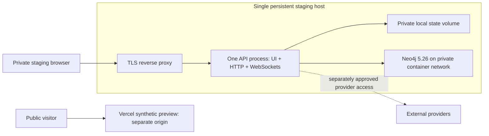

# H1 — Private hosted staging contract

Baseline: `5eee662`. Status: architecture and acceptance specification; deployment
is not implemented or approved by this document. H1 is a new, bounded staging
milestone. It closes the hosted acceptance gap in M6 without claiming completion
of M0, M3, real-provider evaluation, or a production service.

## Decision and topology

Run one long-lived Python 3.11 API process on one persistent host. A TLS reverse
proxy serves the original application UI, `/api/*`, and `/ws/graph` through the
same dedicated staging origin. The application serves `frontend/index.html` and
vendored assets; **do not inject `frontend/preview.js` into private staging**.

Vercel retains its existing static synthetic preview and release gate. It receives
no staging credentials or private graph data and does not proxy this first hosted
backend. A split-origin frontend, Vercel proxy, shared-state migration, multiple
API workers, autoscaling and high availability require separate contracts.
Serving the private UI from the backend avoids introducing cross-origin session
and WebSocket authentication behavior into this slice.

The host runs a non-root application container and a separate Neo4j container with
independent persistent data volumes. Only the TLS ingress is public. Application
port 8000 and Neo4j ports 7474/7687 must be unreachable from outside the host;
host administration uses separately restricted operator access. This is a staging
availability model: host failure interrupts the whole service.

## Frozen implementation boundaries

| Area | Contract |
|---|---|
| Processes | Exactly one API container/process; no reload, extra Uvicorn workers, or overlapping old/new API instances. There are two ingest worker tasks per enabled workspace; record and bound the enabled-workspace count when sizing the host. |
| State | Local persistent filesystem suitable for SQLite WAL; no ephemeral container layer, NFS, or shared network filesystem. Preserve the complete state directory across restarts. |
| Identity | `AUTH_MODE=private`; missing/invalid identity configuration or durable state must abort startup. Never fall back to local mode. |
| Origin | One exact HTTPS origin without path/trailing slash in `ALLOWED_ORIGINS`; `AUTH_COOKIE_SECURE=1`. Preserve cookie, CSRF and WebSocket Origin checks. |
| Proxy | Preserve public Host and client Origin; overwrite untrusted forwarding headers. Trust forwarded scheme/IP only from the actual proxy, never arbitrary Internet clients. Verify per-IP rate buckets through the proxy. |
| Transport | Forward WebSocket upgrades and bounded uploads; enforce the existing 4 MiB request ceiling at ingress as well as in the app. Preserve API errors, no-store headers and security headers. |
| Persistence | Neo4j owns graphs, Source versions, excerpts and publication receipts. SQLite owns identity/sessions and per-workspace jobs/history/events/usage. No dual-write or schema redesign. |
| Quotas | Set a nonzero `USAGE_REQUEST_LIMIT` and explicit window before hosted acceptance; verify effective private workspace settings. This is a request quota, not a dollar, token or sandbox-count ceiling. |
| Shutdown | Stop research schedules, then jobs, sockets and clients using existing lifecycle order. Measure cleanup; configure process/proxy stop budgets to permit it. Forced termination is a separately tested crash path. |
| Deployment | Stop admission and old API execution before starting the new API process. Use a maintenance response during the interruption; no rolling overlap against the same state. |

No new public API, event envelope, authentication scheme, graph schema or data
migration is authorized by H1. Preserve [M3](M3_CONTRACT.md), [M4](M4_CONTRACT.md),
[M5](M5_CONTRACT.md) and [usage](M3_USAGE.md) contracts. Propose any necessary
runtime change explicitly before implementation rather than hiding it in host
configuration.

## Configuration and operator bindings

Use the Docker image's existing app UID/GID 1000. Mount `/app/data` privately,
owned by that identity, with directories 0700 and state/config files 0600. Example
path bindings are `STATE_DB_PATH=/app/data/identity.sqlite3` and
`AUTH_CONFIG_PATH=/app/data/auth.json`; workspace databases remain under
`/app/data/workspaces/<workspace-id>/`. Bootstrap identities offline using the
existing operator CLI; distribute generated tokens through an approved private
channel. Never put tokens in commands, URLs, logs, images or repository files.

The existing `docker-compose.yml` is a development configuration, not the hosted
deployment manifest: it defaults to local authentication and a development graph
password and does not pass every usage setting. The implementation must supply
an explicit staging configuration with unique Neo4j credentials, private auth,
durable mounts, one worker process, reload disabled, API docs disabled, exact
origins, request limits, stop budgets and resource bounds. Do not overwrite a
developer `.env` or change local defaults to satisfy hosting requirements.

Before provisioning, record the host/provider and region, instance resources,
domain and DNS owner, TLS renewal mechanism, storage capacity, monthly hosting
ceiling, enabled-workspace count, deployment operator, backup destination/encryption/access policy, and
chosen recovery-point/recovery-time objectives. These are **unbound operational
inputs**, not selected vendors, measured guarantees or approved purchases. Also
record exact image/dependency versions and the tested source commit. No host,
DNS, database, Vercel setting or paid resource changes are part of this contract
authoring step.

## Provider and data gates

1. **Local connected acceptance:** run the real app, private identity middleware,
   HTTP/WebSocket transport, SQLite and disposable Neo4j. A controlled test-only
   Kimi-compatible fixture may produce invented extraction/answer responses;
   document its fake credential and endpoint as test inputs. Never add a deployed
   synthetic-success switch to the application.
2. **Hosted provider-free acceptance:** leave real Kimi, Daytona and Nosana keys
   and the semantic embedding URL unset. Deny outbound provider traffic at the
   network boundary. Verify local analytics, hash-fallback reporting, original
   evidence seeded through scoped test setup, and structured missing-Kimi errors.
   Successful real extraction/answers are not claimed in this gate. Test-only
   provider fixtures remain confined to the isolated acceptance environment.
3. **Bounded real-provider pilot:** separately record approved document sources,
   destinations, maximum calls per provider, worst-case estimated cost, retry
   treatment and an operator stop mechanism; obtain explicit budget approval
   before enabling credentials/egress. Existing attempt/request limits and Ask
   token totals do not enforce monetary ceilings or account for all provider
   work. Scheduled refresh and unattended paid work stay disabled until their
   budgets and authorization are implemented and approved.

Use invented public fixtures for gates 1–2. No production corpus or demo database
may be reused. Source URL ingestion must retain SSRF, redirect, DNS pinning and
streaming guards; an outbound provider exception must not open private/internal
source destinations. Keep document bodies, excerpts, prompts, provider secrets,
login tokens and response cookies out of CI artifacts and operational logs.
Scan diagnostic output before sharing it; if a verification credential is created,
revoke it after the check and verify revocation without printing its value.

## Acceptance matrix

All rows are required before calling H1 accepted. Record actual commit/image,
test environment, fixture version, result and evidence boundary for each row.
An unrun or unavailable check remains open; synthetic provider output never
becomes real-provider quality evidence.

| ID | Exercise | Required result |
|---|---|---|
| H1-01 | Start with missing/invalid auth config, unwritable state and absent mount | Startup fails closed, no local-mode/private-data fallback; deployment remains unready. |
| H1-02 | Reach staging over TLS and attempt direct app/Neo4j connections externally | Only intended ingress is reachable; private UI has no preview shim/banner; certificate and origin match. |
| H1-03 | Real browser login, logout, expired session, token rotation and workspace switch | Secure HttpOnly/SameSite cookies; no private localStorage; old answers, credentials and sockets cannot reappear. |
| H1-04 | Two principals/workspaces, guessed IDs, reader mutations, hostile Origin and forwarded headers | No cross-workspace HTTP/WS/provider input; readers cannot mutate or execute sandbox routes; proxy cannot bypass CSRF or impersonate client IPs. |
| H1-05 | Text/file ingestion through actual HTTP and progress through WS plus polling | Controlled local provider fixture publishes scoped evidence, reports coverage, and preserves job/public schemas without raw text in broadcasts. |
| H1-06 | Answer through real HTTP; open citation; refresh/delete evidence; provider unavailable | Current excerpts resolve with exact offsets; stale IDs fail safely; insufficient evidence and unavailable provider remain explicit. Successful answers use only the local fixture in gate 1. |
| H1-07 | Reload, cancel, gracefully stop, and separately kill/restart API | Jobs/history persist. Graceful stop awaits cleanup before releasing permits. Forced-kill recovery uses lease expiry, fencing and bounded reclaim. Also crash after Neo4j publication but before SQLite terminal recording, refresh/delete the source, then replay: receipts prevent duplicate publication or stale resurrection. |
| H1-08 | Revoke a queued job's submitter and a connected socket's membership | No new unauthorized work/chunk/publication or socket delivery; already committed/in-flight races retain documented limits. |
| H1-09 | Exhaust shared Ask/sandbox request allowance and restart API | Requests are denied before work; workspace totals persist and stay isolated; unknown token usage is not displayed as measured zero. |
| H1-10 | Lose Neo4j or fail a state write; separately lose the gate-1 provider fixture; restore dependencies | Graph/state probe failure withholds normal admissions while keeping operator recovery probes reachable. Fixture loss produces structured ingestion failure or `llm_unavailable`; provider-independent operations and readiness remain usable. Errors are sanitized; durable work never falls back to memory; recovery is demonstrated. |
| H1-11 | Attempt oversized upload, disallowed source URL, and secret-bearing diagnostics | Existing input guards still apply behind TLS ingress; diagnostics/artifacts contain no credentials or private content. |
| H1-12 | Back up and restore all state into an isolated environment; deploy/rollback | Identity/membership, graph versions/receipts and saved history agree; no unexpected paid or scheduled work; observed recovery meets preregistered objectives. |
| H1-13 | Deploy exact reviewed image, probe staging and inspect release evidence | All CI jobs pass; authenticated connected-browser smoke passes; zero provider egress during gate 2; acceptance owner signs the actual commit and open limitations. |

`GET /api/health` always returns HTTP 200 and may contain cached availability;
it is not an adequate readiness or private-workspace acceptance check. Keep it
content-free. Readiness must additionally exercise authorized workspace access,
a current graph read and durable-state availability, using operator-held test
credentials without exposing a new unauthenticated data endpoint. Dependency
probe failure must withhold admission; cached health or a static HTML 200 cannot
release traffic. Define probe handling during maintenance so it cannot restart
the application repeatedly or trigger provider work.

## Backup, release and rollback

Back up the identity/config, all workspace SQLite state (including correct WAL
handling), and Neo4j as a coordinated set after stopping admissions, schedules
and API writers. Preserve permissions, encryption and access controls. Restoring
only one database is not a valid recovery plan. Restore rehearsal starts with
provider egress denied and refresh schedules disabled; review retained commands
before opening any provider access. Logical deletion is not secure erasure of
old pages, WAL files or backups.

Build an immutable app image from the reviewed commit, record its digest and
dependency inventory, and deploy to the bound staging environment only after
CI passes. Check the actual private origin and admitted runtime, not the public
synthetic preview. Roll back to a known compatible image/config; schema or state
incompatibility requires the coordinated recovery procedure and explicit data-loss
decision against the recorded recovery objective. Never delete state as a way to
make an older build start. Keep the independent Vercel preview unchanged.

## Worktree ownership and execution order

The following are frozen **planned interfaces**, not commands that exist today:

- `python -m pytest --hosted tests/hosted -q` opts into the connected harness.
  Default offline collection must exclude it before service imports, following
  the browser harness pattern. The integrator owns root pytest configuration.
- The harness starts the real application in a child process with explicit test
  environment and dotenv loading suppressed at its test-only entrypoint. Its
  Kimi fixture speaks `/v1/chat/completions`, uses invented data/fake credentials,
  records call counts without raw bodies, and can pause/fail scripted responses
  to exercise cancellation and crash recovery. Harness service traffic is limited
  to assigned loopback app/proxy/fixture and disposable Neo4j ports; test setup
  must prove accidental external provider access is denied. No fixture hook ships
  in `src/`.
- `python -m scripts.hosted_preflight --config <private-operator-json> --json`
  validates the resolved host/process/mount/configuration bindings without
  provisioning or modifying services. Mount and singleton checks belong here;
  existing app startup alone cannot detect a missing persistent host volume.
- `python -m scripts.hosted_readiness --config <private-operator-json>
  --credential-file <private-token-file> --json` probes the exact bound HTTPS
  origin using a scoped reader test principal. Exercise identity session storage,
  an authorized graph read and workspace state (for example `/api/usage`), revoke
  the probe session after use, and keep tokens/cookies out of output. The ingress
  readiness integration must allow this operator probe through maintenance while
  withholding normal client admissions; otherwise recovery would deadlock.
- Both operator tools return only `{"version":1,"ok":true|false,"checks":[...]}`
  where each check has a stable ID, `pass|fail|unverified`, and a sanitized fixed
  reason code. Exit 0 requires every mandatory check to pass; failed/unverified
  checks exit nonzero. Do not return exception strings, file contents, credential
  values or research data. No new public readiness endpoint is introduced.

| Slice | Exclusive implementation area | Handoff |
|---|---|---|
| A — Connected acceptance | New `tests/hosted/` harness and fixtures; focused test dependencies/config changes agreed first | Actual local HTTP/WS/private-state evidence for H1-03–09; zero paid calls |
| B — Host and lifecycle | New `deploy/staging/` manifests, `scripts/hosted_preflight.py`, `scripts/hosted_readiness.py`, and agreed backup/restore scripts | Same-origin TLS, single process, persistent volumes, readiness, drain and recovery evidence |
| C — Release and observability | `.github/workflows/` and release/operations documentation | Exact-commit/image gate, sanitized failure diagnostics and staging smoke evidence |
| Integrator | Shared `src/main.py`, routes/auth/state modules, root Compose/config, this contract and roadmap | Any runtime gap becomes one reviewed patch with its own regression and explicit file owner |

A can start locally before a host is chosen; B templates and C release design can
proceed alongside it using the interfaces above. Resolve command flags/config
fields through the integrator if more are needed. B's remote execution waits for operator
bindings; C's deployment waits for B plus all gates. A must not depend on the
synthetic Vercel transport. Agents do not edit shared files concurrently or invent
competing probe endpoints. Independent code and security reviewers inspect the
final combined commit and affected callers before hosted acceptance is declared.

Definition of done: all H1 rows have recorded passing evidence, operational
bindings and restore results are filled, the private staging release is reviewed,
and limitations/provider status are visible. A hosted website, passing offline
suite or synthetic graph alone does not satisfy H1. Full provider spend controls,
representative-document claim support, automatic Vercel promotion and multi-host
operation remain subsequent milestones.
